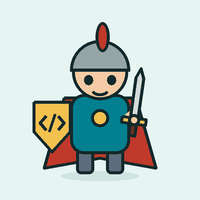
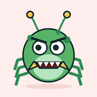

# Week 5: Python to Web Thinking, Intro to HTML

Last week you built the **Battle Arena** in the console. It works, but only **you** can play it, on **your** computer, in a black window.

This week the Arena gets a **face**: a web page that anyone with a browser can open. You'll learn how apps work across a browser, what **frontend** and **backend** mean, and how to use **HTML** to give your content structure.

You can finish it in class, or keep going at home.

---

## The Big Idea

> The **frontend** is what the user **sees and touches**. The **backend** is where the **rules and data** live. **HTML** gives the frontend its structure.

Every program you wrote so far (variables, input, conditions, functions) has a place in a real app. This week you map your **logic** into an **app**.

---

## Meet the Fighters

 &nbsp; **vs** &nbsp; 

**Byte the knight** (with a `</>` shield) fights **Bugzilla the bug monster**. They're animated GIFs: your browser plays them for you. They also have attack and hurt animations, saved for your Open Project if you want your characters to react.

---

## What's in This Folder

```
w5/
├── README.md                          <- you are here
├── messy_battle_arena.html            <- the Arena page with NO structure
├── refactor_battle_arena.html         <- the same page, structured with HTML
├── bug_hunt_battle_arena.html         <- a page with 4 bugs to find and fix
├── images/
│   ├── hero.gif                       <- Byte the knight (the hero)
│   ├── monster.gif                    <- Bugzilla the bug monster
│   ├── pet.gif                        <- Pip, the pet for Stage 3
│   └── ...more animations for your Open Project (hero_attack.gif, monster_hurt.gif, and so on)
├── skeleton/                          <- START HERE: your station's starter file
│   ├── rookie/
│   │   ├── README.MD
│   │   └── rookie_battle_arena.html
│   ├── fighter/
│   │   ├── README.MD
│   │   └── fighter_battle_arena.html
│   └── champion/
│       ├── README.MD
│       └── champion_battle_arena.html
└── solution/                          <- check your work AFTER you've tried
    ├── rookie/
    │   └── sol_rookie_battle_arena.html
    ├── fighter/
    │   └── sol_fighter_battle_arena.html
    └── champion/
        └── sol_champion_battle_arena.html
```

---

## Get the Files

On this GitHub page, click the green **Code** button, then **Download ZIP**. Unzip it, and open the `w5` folder in **VS Code**.

You already have **VS Code** and a **browser**, so you're ready to go. You don't need Python this week.

---

## How Apps Work Across a Browser

When you type a web address and press Enter:

1. Your **browser** (the frontend) sends a **request** to a **server**.
2. The **server** (the backend) finds or builds the page.
3. The server sends back a **response**: usually an **HTML** file.
4. Your browser **reads the HTML and draws the page**.

**HTML is just text.** Your browser turns it into headings, pictures, and buttons.

When you click a button in a real app, the browser sends another request: *"The user clicked Attack."* The backend runs the game rules (like your `attack()` function from last week), and sends back the new result for the page to show.

---

## Start Here: 3 Steps

### Step 1. Pick your station

| Station | Best for | What you do | Your folder |
|---|---|---|---|
| **Rookie** | You want guidance | Fill in the `TODO` comments in a starter page that already has part of the Arena | [`skeleton/rookie`](skeleton/rookie) |
| **Fighter** | You're comfortable and want a challenge | Build the whole Arena page yourself, from a written spec | [`skeleton/fighter`](skeleton/fighter) |
| **Champion** | You want a stretch | Build a three-screen Arena with a form, a table, and semantic layout | [`skeleton/champion`](skeleton/champion) |

Not sure? Pick the one that feels like a **good challenge**, not the easiest and not the hardest. You can always move up a level.

### Step 2. Read your station's README

Each station folder has its own `README.MD` with the full instructions, a **checklist of what you should see in the browser**, and hints:

- [Rookie instructions](skeleton/rookie/README.MD)
- [Fighter instructions](skeleton/fighter/README.MD)
- [Champion instructions](skeleton/champion/README.MD)

### Step 3. Write HTML in the skeleton file

Open your station's `*_battle_arena.html` file in VS Code and start building. **Save and refresh often.** Small steps, then check the browser, then fix.

---

## How to Open Your Page

1. In VS Code, **save** your file (`Ctrl+S`, or `Cmd+S` on a Mac).
2. Find the file in your file explorer and **double-click** it. It opens in your browser.
3. After every change: **save in VS Code, then refresh the browser** (`F5`).

**Tip:** put VS Code on one half of your screen and the browser on the other.

---

## The Three Stages

| Stage | What you do | How you know you're done |
|---|---|---|
| **1. Page foundation** | Set up the page: heading, tagline, and the first section | Your browser shows what your station's checklist says |
| **2. The battle screen** | Build the rest of the Arena: monster, buttons, battle log, result | The page matches the outline in your README |
| **3. Logic to app** | Pick another app idea, **map its logic to HTML elements**, and build one screen | Your map is filled in, and your screen has the required elements |

### Show Moments

At three points in every stage, **everyone shows something**. It doesn't have to be finished. A page with a mistake counts. Nothing doesn't.

1. **Minute 0:** tell your partner *"My first element is ___."*
2. **First show:** open your page in the browser and show your partner.
3. **Spot check:** your teacher picks a few people to show their page and explain one tag.
4. **End of stage:** **pair check.** Your partner compares your page with the checklist.

---

## Logic to App: The Map

This is the key skill this week. Every console idea has a home on a web page.

| In your console game | On the web page |
|---|---|
| `print()` a message | A **list item** in a log, or a **paragraph** |
| `input()` the player's choice | A **button**, or a **form** with an input |
| A **variable**, like `hero_hp` | A piece of text with an **`id`**, like `<span id="hero-hp">` |
| A **function**, like `attack()` | A **button** that will trigger it (in your project) |
| `show_status()` | A **status panel** (headings, a list, pictures) |
| An invalid choice | **Can't happen:** a button only offers valid choices |
| The `while` loop | The page stays open, and **each click is one turn** |
| "You win" message | A **result** section |

**Why `id`?** An `id` is a name tag for an element. Next session, CSS will use it to find and style the element. Later, your own code can use it to change what it shows.

**Keep your Stage 3 map.** It can become the plan for your Open Project.

---

## The Lecture Demo: Structure Matters

Open these two files in your browser, side by side:

- [`messy_battle_arena.html`](messy_battle_arena.html): the same content, with **no structure** (just text and line breaks).
- [`refactor_battle_arena.html`](refactor_battle_arena.html): the same content, with **HTML structure**.

**Try it:**

1. In each file, right-click the page and choose **View page source** (or press `Ctrl+U`).
2. List 3 things the structured version has that the messy one doesn't.
3. Which version could a **screen reader**, a **search engine**, or **your own code** understand better? Why?

### The Bug Hunt

[`bug_hunt_battle_arena.html`](bug_hunt_battle_arena.html) has **4 bugs**. Open it in your browser, find them by looking and testing, then fix them in the file.

| Bug | How you found it |
|---|---|
| 1 | |
| 2 | |
| 3 | |
| 4 | |

---

## Quick Reference: HTML Tags

| What you want | Tag | Example |
|---|---|---|
| A heading (biggest to smallest) | `h1` to `h6` | `<h2>Hero</h2>` |
| A paragraph | `p` | `<p>Hello</p>` |
| A bulleted list | `ul` with `li` items | `<ul><li>One</li></ul>` |
| A numbered list | `ol` with `li` items | `<ol><li>First</li></ol>` |
| A picture | `img` (no closing tag) | `` |
| A link | `a` | `<a href="#rules">Rules</a>` |
| A button | `button` | `<button>Click</button>` |
| A form with a text box | `form`, `label`, `input` | `<label for="name">Name:</label> <input type="text" id="name">` |
| A section of the page | `section`, `div` | `<section id="log">...</section>` |
| A small piece of text to name | `span` | `<span id="score">0</span>` |
| Page layout | `header`, `nav`, `main`, `footer` | `<footer>...</footer>` |
| A table | `table`, `tr`, `th`, `td` | `<table><tr><th>Stat</th></tr></table>` |

**Remember:** most tags come in **pairs** (an opening tag and a closing tag). Tags **nest** inside each other, like Python's indentation.

**Images:** every `img` needs `alt` text. Pictures in this folder are in `images/`. From a station folder, the path is `../../images/hero.gif` (`..` means "go up one folder").

---

## Stuck? Use the Routine

HTML doesn't show error messages. The browser just does its best. So you **look and test**:

1. **Look:** what is wrong on the page?
2. **Locate:** which element is it? Right-click it and choose **Inspect**.
3. **Guess:** say out loud what you think is wrong.
4. **Change one thing.**
5. **Save, then refresh** (`F5`).
6. Still stuck? Compare with your station's checklist, one section at a time.

### Common HTML bugs

| What you see | Check this |
|---|---|
| Everything after one line is **bold** or **huge** | A tag wasn't closed |
| A button is just plain text | Is the tag spelled correctly? |
| A picture shows its `alt` text instead | Is the file path right? Is the file name spelled correctly? |
| Clicking a link does nothing | Does the link's `#name` match the element's `id` **exactly**? |
| Your change doesn't appear | Did you **save**, and **refresh**? |

Still stuck after the routine? Ask your partner or your teacher, and **explain what you see** first.

---

## Using the Solutions

The `solution` folder has a working page for each station. Use it well:

- **Try first.** Give it a real attempt before you look.
- **Look at one section at a time,** not the whole file.
- **Compare, don't copy.** Read the solution, close it, and write your own version.
- **Your page can be different and still correct.** If it matches your station's checklist, it works.

---

## Finished? Level Up

- Done with **Rookie**? Try **Fighter**.
- Done with **Fighter**? Try **Champion**.
- Done with **Champion**? Design a page for an app **you** want to build, and map its logic first.
- **Look ahead:** your buttons don't do anything yet. Next session, **CSS** (Design for Web Browser) makes your page look good. Then comes your **Open Project**, where you decide how far to take your app, and the **Final Demo**, where you show it.

---

## One Last Thing

Your Arena has two sides now: the **frontend** (what players see) and the **backend** (the rules).

In 2 or 3 sentences: **which parts of your Battle Arena are frontend, and which are backend?** Use examples from your own page and your Python code from last week.

> Example: *"The Attack button and the HP numbers are frontend, because the player sees and clicks them. The `attack()` function is backend, because it follows the rules and decides the damage."*

Save your work, and keep this folder. Next session builds on it.
