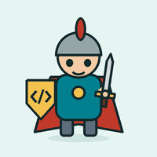
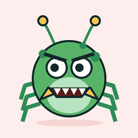

# Station: Champion

**Your goal:** Build a **three-screen Battle Arena** with clean, meaningful HTML, then **design your own app** and decide what belongs in the frontend and the backend.

This handout gives you constraints and challenges, not steps. How you structure it is up to you.

> **How to read this handout:** "Expected" tells you what you should **see in the browser**. Your page must **meet every requirement**. Small differences (like picture sizes) are fine.

---

## The Project

**Your fighters:**  **Byte the knight** (the hero) vs  **Bugzilla the bug monster**. Byte has a `</>` shield. Bugzilla is made of bugs. Fitting, after the bug hunt!

A real app has more than one **screen**. You'll build three screens inside one page, and connect them with links.

| Screen | id | Purpose |
|---|---|---|
| **Title** | `title-screen` | Tagline, how to play, and a form to set up the game |
| **Arena** | `arena-screen` | The battle: stats, status, buttons, and the log |
| **Game over** | `game-over-screen` | The result, and a way to play again |

---

## Your Starter File: `champion_battle_arena.html`

It gives you the page skeleton, a **`LOGIC MAP` comment** to fill in, and comments describing each screen. Read them carefully: they are your spec. You write everything inside.

**How to see your page:** save in VS Code (`Ctrl+S`), double-click the file to open it in your browser, and **refresh (`F5`) after every change.**

Pictures are in `../../images/`: `hero.gif` (Byte the knight) and `monster.gif` (Bugzilla the bug monster).

---

## Show Moments

At three points in each stage, **you show something**. It doesn't have to be finished.

1. **Minute 0:** tell your partner *"My first element is ___."*
2. **First show:** open your page in the browser and show your partner.
3. **Spot check:** your teacher may ask you to show your page and explain one tag.
4. **End of stage:** **pair check.** Your partner compares your page with the requirements.

---

## Stage 1: The Frame and the Title Screen (8 min)

### Requirements

1. **Semantic layout.** The page uses `header`, `nav`, `main`, and `footer`.
   - `header`: contains the `h1` `Battle Arena` and a `nav` with links to your three screens.
   - `main`: contains the three screens, each as a `section` with its id.
   - `footer`: a short line of text.
2. **The title screen** (`id="title-screen"`) contains:
   - A heading and the tagline `A hero fights a monster. The first to reach 0 HP loses!`
   - A collapsible **How to play** (`details` with a `summary`) holding a numbered list of 4 rules (the same rules as the Rules list in the Fighter handout)
   - A **form** with:
     - A hero name: a **label** connected to a **text input** (`id="hero-name"`)
     - **Difficulty:** three **radio buttons** (Easy, Normal, Hard) grouped in a `fieldset` with a `legend`. **Normal** is selected by default
     - **Monster type:** a drop-down (`select`) with `Goblin`, `Orc`, and `Dragon`
     - A `Start Battle` button
3. **Every form control has a connected `label`.**

### Expected in the browser

```
Battle Arena
Title | Arena | Game over            <- links in the header

Title screen
A hero fights a monster. The first to reach 0 HP loses!
▸ How to play                        <- click it and the rules open
Hero name: [ text box ]
┌ Difficulty ─────────────────┐
│ ( ) Easy  (•) Normal  ( ) Hard │
└────────────────────────────┘
Choose your monster: [Goblin ▾]
[Start Battle]

(footer text at the bottom)
```

### Hints

- Radio buttons that belong together share the same `name`, and each has its own `id` and `label`.
- `details` shows its `summary` and hides everything else until clicked.
- Be careful with the closing tags of the **form**, **fieldset**, and **section**. Indentation will show you if something is out of place.

**Checkpoint:** the title screen shows all its parts, and the **How to play** opens when clicked.

---

## Stage 2: The Arena and Game Over Screens (14 min)

### Requirements

1. **The arena screen** (`id="arena-screen"`) contains:
   - A **table** of stats with a header row (`thead`) and a body (`tbody`), with these columns and rows:

     | Stat | Hero | Monster |
     |---|---|---|
     | Starting HP | 100 | 100 |
     | Damage | 5 to 15 | 5 to 15 |
     | Healing | 15 HP | 15 HP (sometimes, when under 30 HP) |

   - A **status panel** (`id="status-panel"`) with the hero picture and `Hero HP: 100` (the number in a `span` with `id="hero-hp"`), and the monster picture and `Monster HP: 100` (`id="monster-hp"`)
   - Three buttons: `Attack` (`id="attack-btn"`), `Heal` (`id="heal-btn"`), `Defend` (`id="defend-btn"`)
   - A **numbered list** (`id="battle-log"`) with 3 sample entries: `Hero hits for 12`, `Monster hits for 9`, `Hero heals!`
2. **The game over screen** (`id="game-over-screen"`) contains:
   - A paragraph (`id="result"`) that says `You win! The monster is defeated.`
   - A **Play again** link that jumps back to the title screen
3. **Fill in the `LOGIC MAP` comment.** For each console idea, write the id of the element that replaces it.
4. **Above each element that replaces console logic, add a comment** that says what it replaces. For example: `<!-- replaces: print("Hero hits for", damage) -->`.
5. **Page rules:**
   - Every picture has `alt` text
   - Headings go in order and never skip a level
   - No duplicate `id` values
   - Indentation shows nesting

### Expected in the browser

```
Arena
 ┌───────────────────────────────────────┐
 │ Stat         Hero    Monster          │   <- a table
 │ Starting HP  100     100              │
 │ Damage       5 to 15 5 to 15          │
 │ Healing      15 HP   15 HP (sometimes…)│
 └───────────────────────────────────────┘
Status
[hero picture]    Hero HP: 100
[monster picture] Monster HP: 100

Your move
[Attack] [Heal] [Defend]

Battle log
 1. Hero hits for 12
 2. Monster hits for 9
 3. Hero heals!

Game over
You win! The monster is defeated.
Play again                              <- a link
```

**Test your links:** click each link in the header and **Play again**. All should jump to the right screen.

### Hints

- You can't use the same `id` twice. The table shows **fixed** stats, so the HP `span`s with ids belong in the status panel only.
- A table row is made of cells: `th` for headings, `td` for data.
- Think about it: why does the console's "invalid choice" message **disappear** in the web version?

**Checkpoint:** all three screens show, all links work, and your `LOGIC MAP` is filled in.

---

## Stage 3: Design Your Own App (10 min)

Choose an app **you** want to build (a quiz, a pet, a tracker, a game of your own). Plan it like a developer: **logic first.**

### Requirements

1. **A map** with at least **6 rows**:

   | Console idea (variable, function, input, or print) | On the web page | HTML element | `id` |
   |---|---|---|---|
   | | | | |

2. **Three screens**, written as `section`s with ids, and a **flow** written as comments (for example: *title, then play, then results, then back to title*).
3. **Build the first two screens** in `my_app.html` in this folder, with `header`, `main`, and `footer`.
4. **Label frontend and backend with comments.** For each part of your app, add a comment: `<!-- FRONTEND -->` for what the user sees and touches, or `<!-- BACKEND later: ... -->` for the rules and data that a server would handle.
5. **At the top of the file, write 2 sentences** (in a comment): which of your functions would live in the **backend**, and **why**?

### Expected

Anyone reading your file can tell **what each element is for**, **where it came from in the logic**, and **which side (frontend or backend) owns it**.

**Checkpoint:** the map has 6 or more rows, the first two screens are built, and your comments are in place.

**Keep your map.** You can use it to plan your Open Project.

---

## Done Checklist

- [ ] Semantic layout: `header`, `nav`, `main`, `footer`
- [ ] All three screens exist with the correct ids, and all links work
- [ ] The title screen has the `details`, the name input, three radio buttons, the `select`, and the button
- [ ] The arena screen has the table, the status panel, three buttons, and the log
- [ ] The game over screen has the result and a **Play again** link
- [ ] The `LOGIC MAP` is filled in, and each element has a `replaces` comment
- [ ] Every image has `alt`, every control has a `label`, headings go in order, and there are no duplicate ids
- [ ] Stage 3: a map with 6 or more rows, two screens built, and frontend/backend comments
- [ ] Your partner signed off on your page
- [ ] Your files are saved

**Finished early?** Sit with a Rookie as a code buddy. Ask what they've tried first, and point at the element instead of fixing it for them. Or add a fourth screen to your own app.
