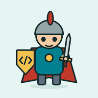
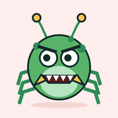

# Station: Fighter

**Your goal:** Build the **Battle Arena web page** from a spec, then **map your Python logic** to another app idea.

This handout gives you requirements, not step-by-step instructions. Decide the order yourself.

> **How to read this handout:** "Expected" tells you what you should **see in the browser**. Your page must **match the requirements**. Small differences (like the exact picture size) are fine.

---

## The Project

**Your fighters:**  **Byte the knight** (the hero) vs  **Bugzilla the bug monster**. Byte has a `</>` shield. Bugzilla is made of bugs. Fitting, after the bug hunt!

Last week the Arena ran in the console. Now it gets a web page.

| In your console game | On your web page |
|---|---|
| `show_status()` | The **Arena** section with the hero and the monster |
| `input()` for `a`, `h`, or `d` | **Attack**, **Heal**, and **Defend** buttons |
| `print()` log lines | The **Battle log** |
| The win / lose message | The **Result** section |
| The player's name | A **form** with a text box |

---

## Your Starter File: `fighter_battle_arena.html`

It gives you only the page skeleton (`<!DOCTYPE html>`, `<html>`, `<head>`, `<body>`). Everything inside `<body>` is yours.

**How to see your page:** save in VS Code (`Ctrl+S`), double-click the file to open it in your browser, and **refresh (`F5`) after every change.**

Pictures are in `../../images/`: `hero.gif` (Byte the knight) and `monster.gif` (Bugzilla the bug monster).

---

## Show Moments

At three points in each stage, **you show something**. It doesn't have to be finished.

1. **Minute 0:** tell your partner *"My first element is ___."*
2. **First show:** open your page in the browser and show your partner.
3. **Spot check:** your teacher may ask you to show your page and explain one tag.
4. **End of stage:** **pair check.** Your partner compares your page with the requirements.

---

## Stage 1: The Top of the Page and the Rules (8 min)

### Requirements

1. A main heading (`h1`): `Battle Arena`
2. A tagline paragraph: `A hero fights a monster. The first to reach 0 HP loses!`
3. **Navigation:** three links that jump to sections further down the page: **Rules**, **Arena**, and **Battle log**. (You'll create those sections as you go.)
4. A **Rules section** (`id="rules"`) with a heading `Rules` and a **numbered list** of these 4 rules:
   - `Both fighters start with 100 HP.`
   - `Each turn you choose to attack or heal.`
   - `The monster attacks back if it is still alive.`
   - `The first to reach 0 HP loses.`

### Expected in the browser

```
Battle Arena
A hero fights a monster. The first to reach 0 HP loses!
Rules | Arena | Battle log        <- three links

Rules
 1. Both fighters start with 100 HP.
 2. Each turn you choose to attack or heal.
 3. The monster attacks back if it is still alive.
 4. The first to reach 0 HP loses.
```

### Hints

- A link needs two things: the **text** people click, and where it **goes**. To jump within the page, the destination starts with `#` and matches an element's `id`.
- The links to **Arena** and **Battle log** won't work until you build those sections in Stage 2.

**Checkpoint:** the heading, tagline, links, and rules all show.

---

## Stage 2: The Battle Screen (14 min)

### Requirements

Build these sections, **in this order**, below the rules. Each section is a `section` with the id shown.

| Section | id | Must contain |
|---|---|---|
| **Hero setup** | `hero-setup` | A heading `Name your hero`. A **form** with a **label** and a **text input** (`id="hero-name"`) for the hero's name, and a button `Start Battle` |
| **Arena** | `arena` | A heading `Arena`. A smaller heading `Hero`, the hero picture, and a list with `HP: 100` (put the 100 in a `span` with `id="hero-hp"`). The same for the `Monster`, with `id="monster-hp"` |
| **Actions** | `actions` | A heading `Your move`, and **three buttons**: `Attack` (`id="attack-btn"`), `Heal` (`id="heal-btn"`), `Defend` (`id="defend-btn"`) |
| **Battle log** | `log` | A heading `Battle log`, and a **numbered list** with `id="battle-log"` and 3 entries: `Hero hits for 12`, `Monster hits for 9`, `Hero heals!` |
| **Result** | `result-section` | A heading `Result`, and a paragraph with `id="result"` that says `The battle has not started yet.` |

**Page rules:**

- Every picture has `alt` text.
- The text input has a **label** connected to it.
- Headings go in order: `h1`, then `h2`, then `h3`. Don't skip levels.
- **Indentation shows nesting.** An element inside another is indented one level.
- Put an HTML **comment** above each section.

### Expected in the browser

```
(everything from Stage 1)

Name your hero
Hero name: [ text box ] [Start Battle]

Arena
  Hero
  [hero picture]
   • HP: 100
  Monster
  [monster picture]
   • HP: 100

Your move
[Attack] [Heal] [Defend]

Battle log
 1. Hero hits for 12
 2. Monster hits for 9
 3. Hero heals!

Result
The battle has not started yet.
```

**Test your links:** click **Arena** and **Battle log** at the top. They should jump to the right sections.

### Hints

- A **form** groups inputs. A `label` is connected to an input by the label's `for` matching the input's `id`.
- If a link does nothing, check that the `#name` matches the `id` **exactly**, including spelling.
- Clicking **Start Battle** will reload the page. That's normal: nothing is connected yet.

**Checkpoint:** your page matches the outline, all three links work, and your partner confirms the requirements.

---

## Stage 3: Logic to App (10 min)

Pick **one** console idea and map its logic to a web page.

**Option A: Quiz Show.** In the console: `score`, `question`, and `check_answer()`.
**Option B: Guess the Number.** In the console: `secret`, `attempts`, and `check_guess()`.
**Option C:** your own idea (check with your teacher).

### Step A: fill in a map (at least 4 rows)

| Console idea | On the web page | HTML element | `id` |
|---|---|---|---|
| | | | |
| | | | |
| | | | |
| | | | |

### Step B: build one screen

In **this folder**, create `my_app.html` (copy the skeleton from your Arena file). It must have:

- A main heading and a tagline
- At least **one list**
- At least **two buttons**, **or** a **form** with a label and an input
- At least **three elements with an `id`** named after your console variables
- **Sections** with comments above them

**Idea starters:**

| Option | Elements to include |
|---|---|
| **Quiz Show** | The score, the question text, three answer buttons, and a feedback line |
| **Guess the Number** | A number input with a label, a Guess button, a hint line, an attempts count, and a list of past guesses |

### Expected

Your page shows a clear screen where **every console idea in your map has a home**. Your partner can name the element for each row.

**Checkpoint:** the map has 4 or more rows, and `my_app.html` meets the requirements.

**Keep your map.** You can use it to plan your Open Project.

---

## Done Checklist

- [ ] Stage 1: heading, tagline, three links, and the numbered rules
- [ ] Stage 2: hero setup form, arena, three buttons, log, and result
- [ ] All the `id` values match the requirements
- [ ] Every image has `alt`, and the input has a connected `label`
- [ ] Headings go in order, and indentation shows nesting
- [ ] All three links jump to the right sections
- [ ] Stage 3: the map has 4 or more rows, and `my_app.html` is built
- [ ] Your partner signed off on your page
- [ ] Your files are saved

**Finished early?** Try the Champion station: a three-screen page with a table, radio buttons, a drop-down menu, and `header`, `main`, and `footer`.
