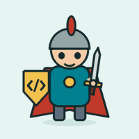
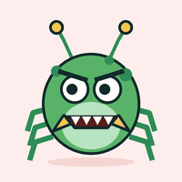

# Station: Rookie

**Your goal:** Build the **Battle Arena web page** with HTML, then **map your Python logic** to a new app idea.

Take it one step at a time. Getting stuck is normal. Look at the page, find the element that's wrong, and change one thing.

> **How to read this handout:** "Expected" tells you what you should **see in the browser**. Your page must **match the checklist**. Small differences (like the exact picture size) are fine.

---

## The Project

**Your fighters:**  **Byte the knight** (the hero) vs  **Bugzilla the bug monster**. Byte has a `</>` shield. Bugzilla is made of bugs. Fitting, after the bug hunt!

Last week the Arena ran in the console. Now it gets a web page. Here is how the console parts become page parts:

| In your console game | On your web page |
|---|---|
| `show_status()` | The **Hero** and **Monster** sections with their HP |
| `input()` for `a` or `h` | **Attack** and **Heal** buttons |
| `print()` log lines | The **Battle log** list |
| The win / lose message | The **Result** section |

**The text your page must show (match it exactly):**

| Element | Text |
|---|---|
| Main heading | `Battle Arena` |
| Tagline | `A hero fights a monster. The first to reach 0 HP loses!` |
| Hero and monster HP | `HP: 100` |
| Buttons | `Attack` and `Heal` |
| Battle log (3 items) | `Hero hits for 12`, `Monster hits for 9`, `Hero heals!` |
| Result | `The battle has not started yet.` |

---

## Your Starter File: `rookie_battle_arena.html`

It already has the page skeleton (`<!DOCTYPE html>`, `<html>`, `<head>`, `<body>`) and a **worked example**: the Hero section is finished. Read it first. You'll fill in the **TODO** comments.

**How to see your page:** save in VS Code (`Ctrl+S`), double-click the file to open it in your browser, and **refresh (`F5`) after every change.**

**Two ideas to know:**

- Most tags come in **pairs**: an opening tag and a closing tag. Whatever is between them is the content.
- An **`id`** is a name tag for an element. Next session, CSS will use it to find and style the element.

---

## Show Moments

At three points in each stage, **you show something**. It doesn't have to be finished.

1. **Minute 0:** tell your partner *"My first element is ___."*
2. **First show:** open your page in the browser and show your partner.
3. **Spot check:** your teacher may ask you to show your page and explain one tag.
4. **End of stage:** **pair check.** Your partner compares your page with the checklist.

---

## Stage 1: The Top of the Page (8 min)

### Your steps

1. **Read the worked example** (the Hero section). Find: the heading, the picture, the list, and the `id`.
2. **TODO 1:** add a main heading (`h1`).
3. **TODO 2:** add the tagline paragraph (`p`).
4. **Save, then open the page in your browser.**

### Expected in the browser

```
Battle Arena                      <- a big heading
A hero fights a monster. ...      <- a normal paragraph
Hero                              <- a smaller heading
[hero picture]
 • HP: 100
```

### Hints

- A heading tag looks like `<h1>...</h1>`. Where does the text go?
- If your page is blank, check that you saved and refreshed.

**Checkpoint:** you see the big heading, the tagline, and the hero section.

---

## Stage 2: The Battle Screen (14 min)

### Your steps

Copy the **pattern** of the hero section for the monster, then build the rest.

1. **TODOs 3 to 5, the Monster:** a heading, the monster picture, and a list with the HP.
2. **TODOs 6 and 7, the Actions:** a heading and two buttons. Give them the ids shown in the TODO.
3. **TODOs 8 and 9, the Battle log:** a heading and an **ordered list** (numbered) with the three entries.
4. **TODO 10, the Result:** a heading and a paragraph with the id shown.

### Expected in the browser

```
Battle Arena
A hero fights a monster. The first to reach 0 HP loses!

Hero
[hero picture]
 • HP: 100

Monster
[monster picture]
 • HP: 100

Your move
[Attack] [Heal]                   <- real buttons, not plain text

Battle log
 1. Hero hits for 12              <- numbered
 2. Monster hits for 9
 3. Hero heals!

Result
The battle has not started yet.
```

### Hints

- A **bulleted** list is `ul`. A **numbered** list is `ol`. Each item inside is an `li`.
- An image tag has **no closing tag**. Its details go inside the tag, like `src` and `alt`.
- The picture path from this folder is `../../images/...` (`..` means "go up one folder").
- If a button looks like plain text, check how you spelled the tag.

**Checkpoint:** your page matches the outline above, and your partner confirms it with the checklist.

---

## Stage 3: Logic to App (10 min)

Now map **another** console idea to a web page: a **Virtual Pet**.

In the console version, the pet has `hunger`, `energy`, and `happiness` (variables), and the functions `feed()`, `play()`, and `sleep()`. Each one prints a message.

### Step A: finish the map

Fill in the **HTML element** column. Think: which tag would you use?

| Console idea | On the web page | HTML element |
|---|---|---|
| The variable `hunger` | A number shown in a list | `li` with a `span` and an `id` |
| The variable `energy` | | |
| The variable `happiness` | | |
| The function `feed()` | A button | |
| The function `play()` | | |
| The function `sleep()` | | |
| `print()` messages | A log of what happened | |

### Step B: build the screen

In **this folder**, create a new file called `my_pet.html` (copy the skeleton from your Arena file). Build it with these parts:

1. A main heading: `Virtual Pet`
2. A tagline paragraph: `Keep your pet happy. Feed it, play with it, and let it sleep!`
3. A heading `Pet`, a picture (use `../../images/pet.gif`, with `alt="Pip the pet"`), and a bulleted list of 3 items: `Hunger: 50`, `Energy: 50`, `Happiness: 50`. Put each number in a `span` with its own id: `hunger`, `energy`, `happiness`.
4. A heading `Actions`, and three buttons: **Feed**, **Play**, **Sleep**. Give them ids: `feed-btn`, `play-btn`, `sleep-btn`.
5. A heading `Pet log`, and a numbered list with 2 sample entries.

### Expected in the browser

```
Virtual Pet
Keep your pet happy. Feed it, play with it, and let it sleep!

Pet
[picture]
 • Hunger: 50
 • Energy: 50
 • Happiness: 50

Actions
[Feed] [Play] [Sleep]

Pet log
 1. (any message)
 2. (any message)
```

**Checkpoint:** your map is filled in, and your `my_pet.html` matches the outline.

**Keep your map.** You can use it to plan your Open Project.

---

## Done Checklist

- [ ] Stage 1: heading, tagline, and the hero section show correctly
- [ ] Stage 2: the monster, buttons, numbered log, and result all show
- [ ] The buttons look like **real buttons**
- [ ] Every image has `alt` text
- [ ] Every element in the TODOs has the `id` it asked for
- [ ] Stage 3: the map is filled in, and `my_pet.html` matches the outline
- [ ] Your partner signed off on your page
- [ ] Your files are saved

**Finished early?** Try the Fighter station: add a **Defend** button, a **form** to name your hero, and links that jump to sections of the page.
